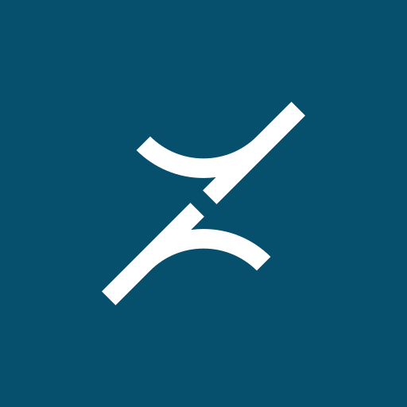

# Zenith for Claude

Zenith connects Claude to the Google Ads accounts your agency or team manages. Ask in plain language and get the figures as cards: account overviews against the period before, campaign performance, keywords and search terms, audits rated by severity, and suggestions ordered by your goal. Anything else Google Ads reports on is a Google Ads Query Language (GAQL) query away, written by Claude.

Zenith only reads. It never changes a campaign, a budget, a bid or any other setting in Google Ads.

## What's in this plugin

- **The Zenith connector.** Zenith's remote MCP server at `https://mcp.zenith.ly/mcp`, with 13 read-only tools: `list_accounts`, `get_workspace`, `get_user_context`, `execute_gaql`, `render_data_table`, `get_gaql_doc`, `get_reporting_view_doc`, `get_reporting_fields_doc`, `get_account_dashboard`, `run_account_audit`, `get_campaign_performance`, `get_keyword_analysis` and `get_optimization_suggestions`.
- **Three skills** that teach Claude how to use them well:
  - `google-ads-audit`: an audit for the goal you name (efficiency, scale or revenue), turned into a plan in order of impact.
  - `google-ads-report`: a client-ready report on a period against the one before, for one account or several.
  - `google-ads-query`: custom reports in GAQL, run through Zenith and shown as a table.

The plugin runs nothing on your computer: no hooks, scripts or local servers.

## What you need

- A Zenith workspace with at least one Google Ads account connected. Create one at [zenith.ly](https://zenith.ly) and connect Google Ads with your Google account.
- Each person connects Claude with their own Zenith sign-in, and sees their workspace's accounts.

## Install

- **Claude (web, desktop and mobile):** add Zenith from Claude's directory of plugins and connectors. Before it is listed there, add it under Settings → Connectors → Add custom connector, with the URL `https://mcp.zenith.ly/mcp`.
- **Claude Code:** run `/plugin marketplace add zimamedia/zenith-claude`, then `/plugin install zenith@zenith`, then `/mcp` to sign in to Zenith.

The first time Zenith is used, Claude sends you to Zenith's own page to sign in and choose **Allow**. Claude registers itself with Zenith: there is no client ID or secret to enter.

Then ask, for example:

- "Which Google Ads accounts do I have in Zenith?"
- "Give me an overview of my Google Ads account for the last 30 days."
- "Audit my account. My goal is a lower cost per conversion."
- "What were the top 10 search terms by cost last week?"

## What it sends, and where

- Claude calls Zenith's server, `https://mcp.zenith.ly/mcp`, over HTTPS, with the access token Zenith issued when you allowed it. Zenith reads Google Ads for the accounts in your workspace, through the Google authorization your workspace gave it, and answers with the figures. Google's tokens never leave Zenith.
- What Claude sends to Zenith is each tool's arguments: an account's `customer_id`, a period, a goal, or a GAQL query. Zenith doesn't receive your conversation.
- The cards are a page Zenith's server provides. Claude shows it in a sandboxed frame, which loads its script and styles from `mcp.zenith.ly` and the MCP Apps library from `esm.sh`.
- You can disconnect Claude at any time in Zenith, under Profile & sign-in → Connected apps, and it stops at once.

Privacy policy: [zenith.ly/privacy](https://zenith.ly/privacy/). Terms: [zenith.ly/terms](https://zenith.ly/terms/).

## Support

[zenith.ly/support](https://zenith.ly/support/)

## License

MIT, © Zima Media. See [LICENSE](LICENSE).
